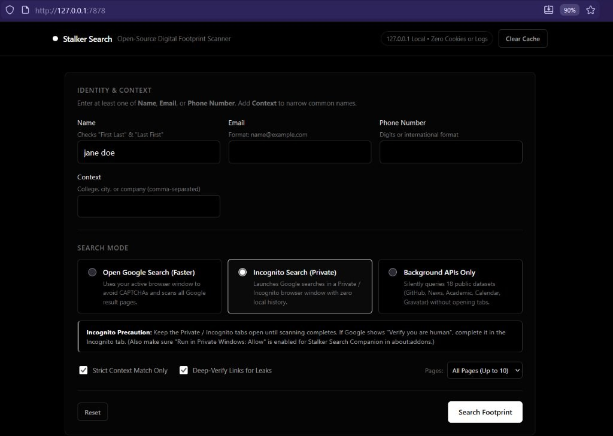

# Stalker Search

A free, open source, zero telemetry, local personal privacy and OSINT scanner built in Rust with a companion extension for Firefox based browsers. Tested on **Arch Linux**, **Kali Linux**, and **Windows**.

Stalker Search helps you find what is publicly exposed under your name, email, or phone number (10 digit, 11 digit, and `+91` or country code formats) so you can remove leaked documents, public calendars, profiles, and contact details before a stalker finds them.

> **Disclaimer:** For defensive privacy awareness and authorized use only (personal self audits, authorized investigations, penetration testing, or security research). Do not use for harassment, stalking, or unauthorized surveillance.



---

## Supported Browsers

Works only with **Firefox based browsers** (**LibreWolf** is used and recommended by me, along with **Mozilla Firefox**, **Zen Browser**, **Floorp**, **Waterfox**, and **Mullvad Browser**).

> **Important: Keep ONLY the browser where you loaded the companion addon open (close other browsers before scanning) so Stalker Search does not open scan tabs in the wrong browser.**

---

## Step 1: Install & Launch

### Linux (Arch, Kali, Fedora, Ubuntu, Debian, Mint)

1. Install prerequisites:
   - **Arch Linux**: `sudo pacman -S --needed base-devel pkgconf openssl rust`
   - **Kali / Ubuntu / Debian / Mint**: `sudo apt update && sudo apt install -y build-essential pkg-config libssl-dev rustc cargo`
   - **Fedora**: `sudo dnf install -y gcc pkg-config openssl-devel rust cargo`
2. Clone and run:
   ```bash
   git clone https://github.com/Venky7514/Stalker-Search.git
   cd Stalker-Search
   cargo run --release
   ```
   (If the window does not open automatically, such as when running as `root` on Kali Linux, open **`http://127.0.0.1:7878`** in your browser.)

### Windows (10 / 11)

1. Download **`stalker-search.exe`** and **`stalker-search-companion.zip`** from **[GitHub Releases](https://github.com/Venky7514/Stalker-Search/releases)**.
2. **Unblock the executable:** Right click `stalker-search.exe` -> **Properties** -> check **Unblock** -> **Apply** (or run `Unblock-File .\stalker-search.exe` in PowerShell, or click **More info** -> **Run anyway**), then open `stalker-search.exe`.

---

## Step 2: Add the Companion Extension

You can install the signed addon from Mozilla or load it as a **Temporary Addon** (Temporary mode is preferred if you only want the extension in memory for one session so it is removed when you close the browser):

- **Direct Install from Mozilla Addons:**

  <a href="https://addons.mozilla.org/en-US/firefox/addon/stalker-search-companion/">
    
  </a>

- **Temporary Addon:** Open `about:debugging#/runtime/this-firefox` -> click **Load Temporary Addon...** -> select **`companion_extension/manifest.json`** (Linux) or **`stalker-search-companion.zip`** (Releases).
- **For Incognito Search mode:** Open **`about:addons`** -> click **Stalker Search Companion** -> set **Run in Private Windows** to **`Allow`** (Firefox resets this to "Don't Allow" each time you reload a temporary addon).

---

## Step 3: Run Your Scan

1. Keep only your companion browser open and launch Stalker Search (`cargo run --release` on Linux, `stalker-search.exe` on Windows, or open **`http://127.0.0.1:7878`**). To run on a custom port instead of `7878`, pass `ui --port <PORT>` (for example `cargo run --release -- ui --port 40152` or `.\stalker-search.exe ui --port 40152`).
2. Enter a **Name**, **Email**, or **Phone Number** (add comma separated **Context** like college, city, or company to narrow common names).
3. Choose a Search Mode and click **Search Footprint**:
   - **Open Google Search (Faster)**: Uses your active browser to avoid CAPTCHAs, scans up to 10 Google pages per query, deletes the searched URLs from browser history, and auto closes the tabs once synced.
   - **Incognito Search (Private)**: Opens searches in a Private window so queries are not tied to a Google account or local history (use a **VPN** with this mode to hide lookups from your DNS, ISP, and IP logs). If Google asks to **"Verify you are human"** in the Private tab, complete the check inside that tab and it will finish scanning and auto close the tabs.
   - **Background APIs Only**: Queries 18 public datasets (GitHub, Reddit, News RSS, arXiv, OpenAlex, ORCID, Google Calendar `.ics`, Gravatar, OpenPGP, etc.) without opening browser tabs.

---

## Privacy & Credits

- **100% Free & Zero Telemetry**: Runs on `127.0.0.1` with zero cookies, analytics, or external servers. Use a **VPN** with **Incognito Search** if you want to hide outbound search requests from your DNS and ISP.
- **Inspiration**: Inspired in part by **[mxrch/GHunt](https://github.com/mxrch/GHunt)** for local browser companion architecture and email and calendar pivoting.
